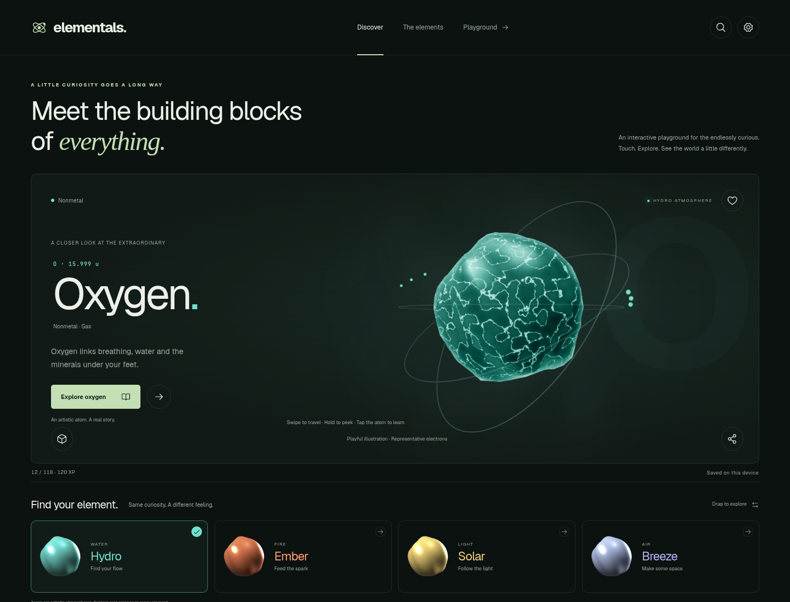
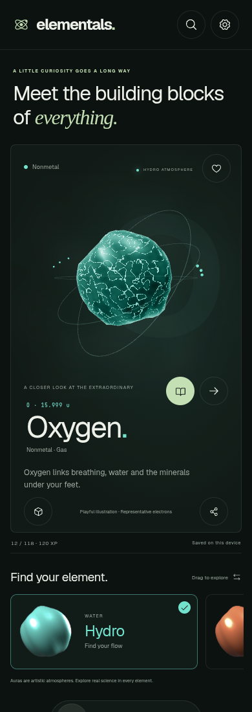

# Elemental experience

The redesign runs in the existing Next.js App Router, React 19, TypeScript and Tailwind 4 application. pnpm 12.9.1 and the committed lockfile are authoritative; this is not a Vite scaffold. Learning records, 118 sourced chemical elements, quizzes, journals, comparison tools, games, deep links and exports retain their existing behavior.

## Source map

```text
app/
  elemental.css                   Responsive mineral palette and experience layout
  sw.js/route.ts                  Versioned production worker and build asset inventory
components/
  elements-explorer.tsx           Selection, gestures, learning state and detail sheets
  elemental-canvas.tsx            Lazy R3F scene, GLB loading, adaptive DPR and optional bloom
  elemental-carousel.tsx          GSAP Draggable, inertia, snapping and keyboard controls
lib/
  elemental.ts                    Four art directions and shared scene API
  elemental-shader.ts             Complete simplex noise, aura and core GLSL shaders
  feedback.ts                     Optional procedural tones and four ambient palettes
public/
  models/{hydro,ember,solar,breeze}.glb
  auras/{hydro,ember,solar,breeze}.png
  fonts/geist-{400,700}.ttf        Self-hosted type with OFL notice
scripts/
  create-elemental-assets.py      Reproducible Blender model and preview generation
  check-deployment.mjs            Staged production smoke checks
```

## Blender assets

The four original models and transparent carousel previews are generated with Blender 4.3 using:

```sh
blender --background --threads 4 --python scripts/create-elemental-assets.py
```

Replace the corresponding files in `public/models/` with your own `.glb` exports, and replace their stills in `public/auras/`. Export a single joined static mesh with normals, centered at the origin at roughly 1.25 Blender units in radius. Apply scale and rotation in Blender. The loader currently uses the first mesh in the GLB. Keep each asset small; the included models are about 32 KB each. The scene supplies its own procedural material, so authored texture maps and animations are not needed. Model loading is isolated by Suspense and an error boundary: a missing model falls back to a procedural sphere, and unavailable WebGL shows the authored still with readable guidance. Science and detail actions work in both cases.

## Interaction and motion

Pointer coordinates are normalized against the actual canvas bounds, with Y inverted into GLSL UV space. `uTouch` interpolates toward the pointer; `uTouchStrength` decays exponentially using elapsed time. Both the aura plane and the sculpted core respond locally. Pointer down handles taps without requiring pointer movement. Shader updates go through mutable uniforms, avoiding React renders per frame.

The four atmospheres are artwork rather than scientific element classifications. Changing atmosphere does not change the selected chemical element or award XP. Native keyboard buttons provide every carousel action. GSAP Draggable and InertiaPlugin handle drag resistance and release snapping. Reduced motion disables the ripple, rotation, float, inertia, marquee and scroll reveals. Rendering stops while a panel is open or the document is hidden. Adaptive quality caps DPR; detailed quality enables bloom. Optional audio is synthesized locally, requires a user gesture, never autoplays after reload, and suspends while the document is hidden.

## Local verification

```sh
pnpm install --frozen-lockfile
pnpm check
pnpm test:unit
pnpm science:check
pnpm build
pnpm test:e2e --workers=2
```

For system Chromium, prefix the last command with `PLAYWRIGHT_CHROMIUM_EXECUTABLE=/usr/bin/chromium`. The production test server starts automatically. `tests/elemental.spec.ts` records actual WebGL uniform writes, verifies mouse coordinates and real Chromium touch events, checks decay and reduced motion, exercises all aura buttons, and forces model/WebGL failures.

The production worker precaches the lazy WebGL chunks, all four models/previews and local fonts. Once offline installation completes, the experience can reload and switch atmospheres without a network connection. Progress remains browser-local. Actual mobile GPU performance, OS install prompts and native browser chrome still need device checks.

See [deployment setup](deployment.md) for the CI, semantic versioning and staged Vercel promotion flow.

## Captured implementation

These screenshots show the running production build, with the introductory tip dismissed through its button.





## Verification record

Local production verification on 2026-10-15 passed lint, formatting, TypeScript, 32 Node unit tests, all 118 scientific records, and the production build. All 166 distinct mobile/desktop Playwright cases passed across a broad run and focused reruns after fixes. The final focused runs passed 28 and 13 cases respectively. GPU tests inspect live WebGL uniform writes rather than component state. Detailed bloom and lightweight quality were also exercised at device scale factor 2: DPR was capped around 1.5 and 1 respectively, with no browser errors.

The first broad run exposed duplicate absolute/relative cache keys and a timing-sensitive instantaneous ripple assertion. Cache installation now normalizes URLs before deduplication, and the GPU test records the observed ripple peak while separately checking live decay. Both have regression coverage. One release-tool dependency advisory has a tested local patch and a documented narrow audit exception; the audit does not claim an advisory-free graph. GitHub CI and actual Vercel promotion still run after source publication/merge; no production release was performed by these local checks.
