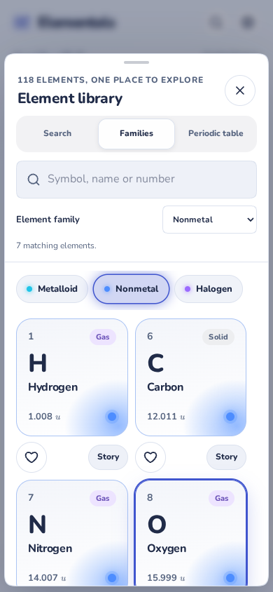
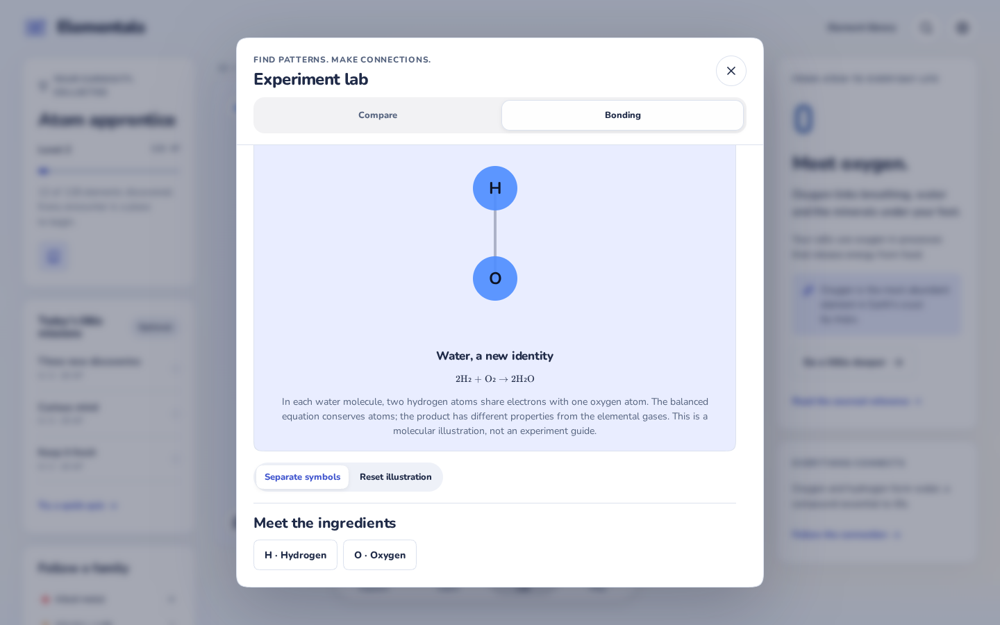

# Fewer panels, connected tools

The explorer previously had eleven separate dialogs and a theme menu. Five shared workspaces now keep related actions together:

| Workspace | Combined features |
| --- | --- |
| Element library | Search, family cards, periodic table, favorites and story entry points |
| Element details | Story, scientific data, shell diagrams and postcards |
| Discovery journal | Learning progress, missions, collections, backups and practice modes |
| Experiment lab | Element comparison and bonding illustrations |
| Settings | Appearance, quality, sensory preferences and exploration help |

Library views share their query and family filter. Lab tabs retain their comparison choices and bonding model while the workspace is open. The Journal lets learners return from practice without dismissing the panel. Element connections update the open story instead of returning to the stage.

Explore, Learn, Lab and Play use labeled navigation with a selection that reflects the active workspace. Games share those destinations and the preferences component, with navigation in the header area so it cannot cover the atom palette or other touch controls. Panels and games respond to browser Back/Forward; panel URLs can open a specific view. Mobile sheets support downward dismissal from their handle, plus an explicit close button. Focus returns to the opener, keyboard tabs work with arrow keys, and motion follows live reduced-motion preferences.

The background atom suspends rendering while a modal is open, keeping its current canvas until the explorer is interactive again. Existing learning data, scientific records and sourced reference routes remain compatible.

## Review screenshots

Captured from the production build at 390 × 844 and 1440 × 900. Onboarding previews also show the updated interface.

## Regression coverage

`tests/workspaces.spec.ts` covers shared filters, favorites, story/postcard navigation, retained Lab state, practice mode changes, panel deep links, browser Back/Forward, game navigation, 320px accessibility, reduced motion, sheet gestures, and background renderer suspension. Existing search, focus, science, learning, game, offline and theme regressions use the consolidated entry points.
